# Squirrel

Squirrel keeps track of the memberships, vouchers, subscriptions and credit-card perks you already have, and reminds you before they expire.

It reads your inbox (read-only) for benefit emails, uses an AI model to pull out each benefit and its expiry date, checks the result with plain code, and sends you an email reminder before anything runs out. Anything the AI isn't sure about goes to a review queue for you to confirm, so it isn't trusted blindly.

<p align="center">
  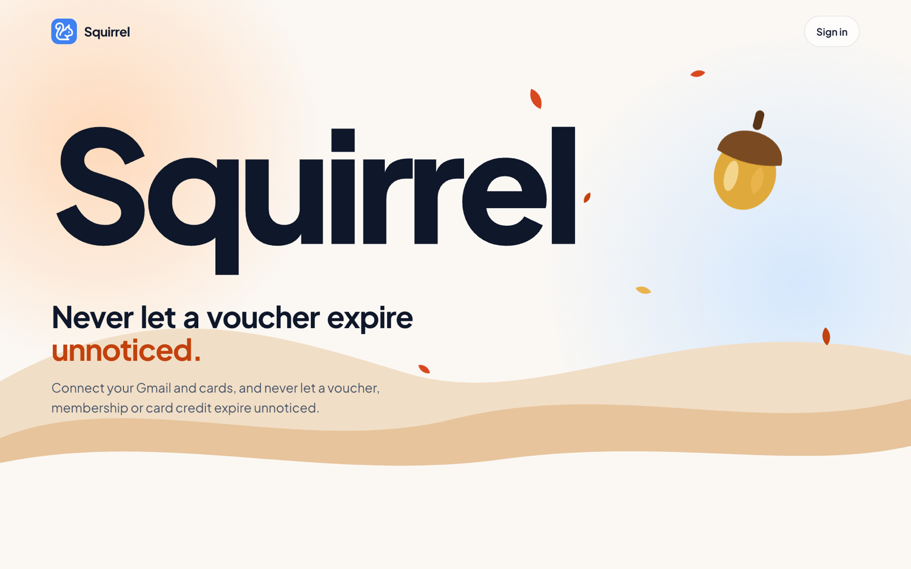
</p>

---

## 1. Problem statement

**What's the problem?** People lose money on benefits they already have. A birthday voucher, a streaming credit on a credit card, a free gym month or a pile of airline miles each come with an expiry date, and those dates sit in hundreds of different emails, apps and card terms. Nobody keeps a list, so benefits expire unnoticed.

**Who has it?**
- Anyone with a busy inbox of retailer, restaurant and loyalty-program emails.
- Holders of premium credit cards (e.g. Amex Platinum, Chase Sapphire Reserve), whose value depends on using monthly, quarterly and yearly credits that reset on different schedules and don't carry over.
- Frequent travellers with hotel and airline memberships whose points expire after a period of inactivity.

**Why is it worth solving?** The money is real and already paid for: a premium card's annual fee is justified only if its credits get used, and unused vouchers and points are simply lost. The information is already in the user's inbox; it just needs reading and organising.

## 2. Solution overview

Squirrel is a web app (React frontend, Python backend) that builds one list of everything you hold, with expiry dates, from three sources:

1. **Your inbox.** Connect Gmail, Outlook or any IMAP mailbox, read-only. Squirrel searches for likely benefit emails, filters out obvious marketing, and asks an AI model to extract each benefit (name, provider, value, expiry date, voucher code, terms). Plain code then checks every result.
2. **Your credit cards.** Pick your cards from a list (25 US and Singapore cards). Squirrel adds each card's recurring credits and works out when they reset. No card numbers or bank connection are ever needed.
3. **Benefits you add by hand.**

From that list, Squirrel:
- shows what expires soonest on a dashboard,
- emails you a reminder before each benefit expires (1 week by default, adjustable per benefit),
- on request, writes an AI weekly digest ranking what needs attention,
- answers questions about your benefits ("what can I use for dinner this week?") with an assistant that only uses your own records.

Uncertain items (no clear expiry date, or a date implausibly far away) go to a **review queue** instead of straight into your list. Offers that have already expired aren't kept.

### How it works

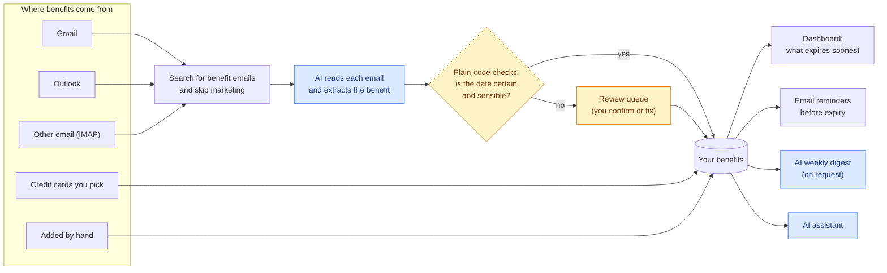

<sub>Blue steps use the AI model; amber steps are plain code and you.</sub>

## 3. Key features

<table>
  <tr>
    <td width="50%">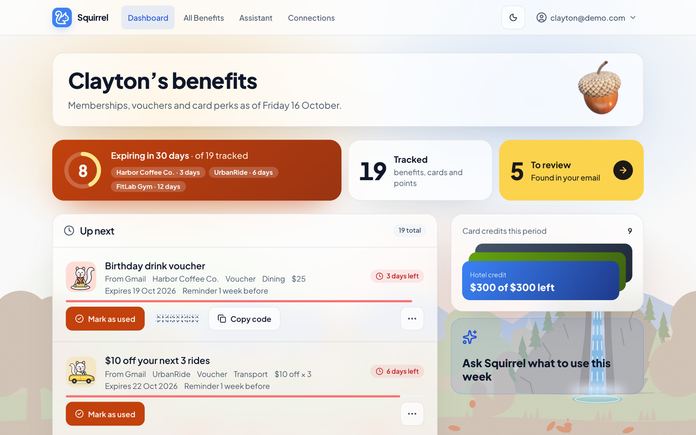<br/><sub><b>Dashboard.</b> What expires soonest, with one tap to mark a voucher used or copy its code.</sub></td>
    <td width="50%">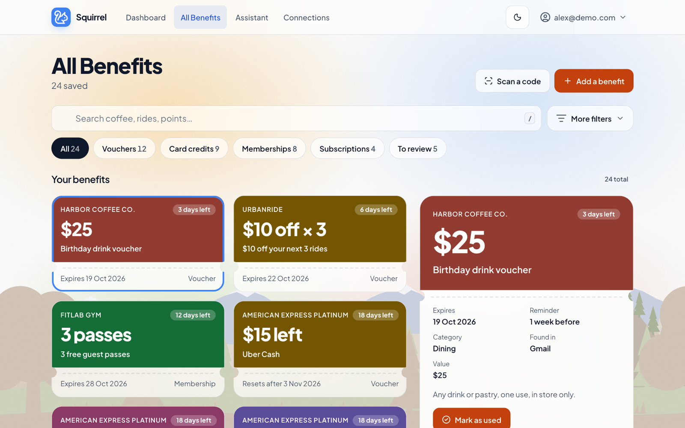<br/><sub><b>All benefits.</b> Search and filter everything you hold; open one for its terms, reminder and source.</sub></td>
  </tr>
  <tr>
    <td width="50%">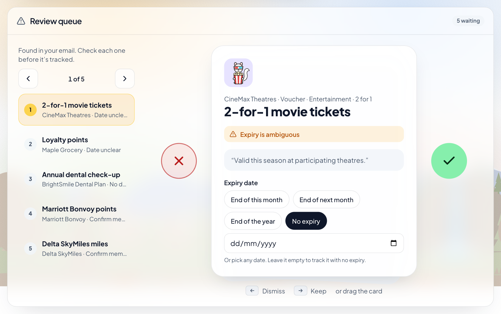<br/><sub><b>Review queue.</b> The AI wasn't sure of this date, so it shows the email's own words and asks you.</sub></td>
    <td width="50%">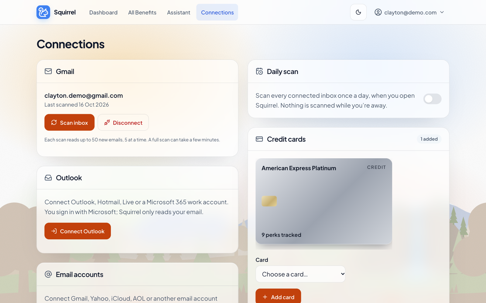<br/><sub><b>Connections.</b> Connect inboxes read-only, turn on the daily scan, and add credit cards.</sub></td>
  </tr>
</table>

<sub>Screenshots are from the server-free demo (<code>demo-frontend/</code>) with made-up sample data.</sub>


- **Inbox scanning** for Gmail (Google sign-in), Outlook / Hotmail / Microsoft 365 (Microsoft sign-in) and other email over IMAP with an app password. All read-only.
- **AI benefit extraction** into a fixed structure, with a confidence level for every expiry date.
- **Review queue** for anything uncertain: confirm, edit or dismiss.
- **Credit-card perk tracking** for 25 cards, with reset dates worked out for monthly, quarterly, half-yearly, calendar-year and card-anniversary credits, and partial use ("$7 of $15 spent this month").
- **Loyalty-membership detection** (no AI) for 13 hotel and airline programs, from who emails you and when, with an estimated points expiry.
- **Email reminders** per benefit (1 week to 1 year before, or off), in your own time zone.
- **Weekly digest**: press Generate on the Assistant page for an AI ranking of your benefits by urgency and value, with a short summary. It's made only when you ask (nothing is sent automatically).
- **Assistant**: ask questions in plain English, answered only from your own benefits.
- **Optional daily scan** of all connected inboxes (off by default).
- **Voucher codes** hidden until tapped, and a camera scanner that reads a QR code or barcode and shows which saved benefit it belongs to (or starts a new benefit with the code filled in).
- **Recently removed** list with undo; removed items are deleted for good after 30 days.
- **Accounts**: email and password or Google sign-in, email verification, password reset, and full account deletion.
- Light and dark mode, and a layout that works on phones.

<p align="center">
  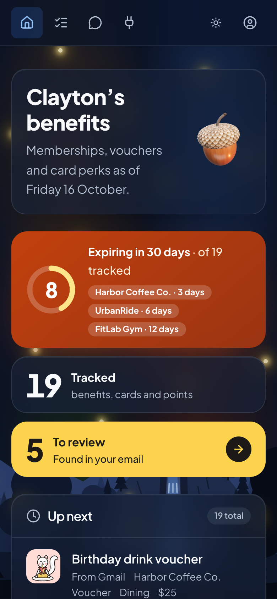<br/>
  <sub>The dashboard on a phone, in dark mode.</sub>
</p>

A **server-free demo** in [`demo-frontend/`](demo-frontend/README.md) runs the whole interface in the browser with sample data (no AI calls, no backend), for showing the app off on Vercel.

## 4. AI integration

Squirrel uses OpenAI's **`gpt-5.4-mini`** model through the Responses API in three places. (The code falls back to `gpt-5.5` if no model is set; we chose `gpt-5.4-mini` because it costs about 7× less.) Everything else, including dates, reminders, card perks and loyalty detection, is plain code.

| Feature | Where | What the AI does | What plain code does |
|---|---|---|---|
| **Benefit extraction** | [`app.py`](app.py), called by [`scan_jobs.py`](scan_jobs.py) | Reads one email and returns a structured record: is it a benefit, name, provider, type, category, value, expiry date, **expiry confidence** (`explicit`, `computed`, `ambiguous`, `unknown`), its reasoning, the exact source phrase, terms and voucher code. | Chooses which emails to send (search keywords, marketing filter, daily cap), validates every field, decides what goes to the review queue, and skips repeated voucher codes and offers that have already expired. |
| **Weekly digest** | [`BenefitIntelligence.py`](BenefitIntelligence.py) | Ranks the user's benefits 1–5 by urgency (how soon vs. how valuable) and writes a 2–3 sentence summary. | Works out days until expiry, refers to benefits by ID and drops any ID the model invented or repeated, uses the real benefit names, and caches the result until something changes. |
| **Assistant (Q&A)** | [`BenefitIntelligence.py`](BenefitIntelligence.py) | Answers the user's question in a short, phone-friendly reply. | Sends only the user's own benefit records (all of them, up to 300; past that, the ones that best match the question's words) as the source of truth. |

### What happens to each email

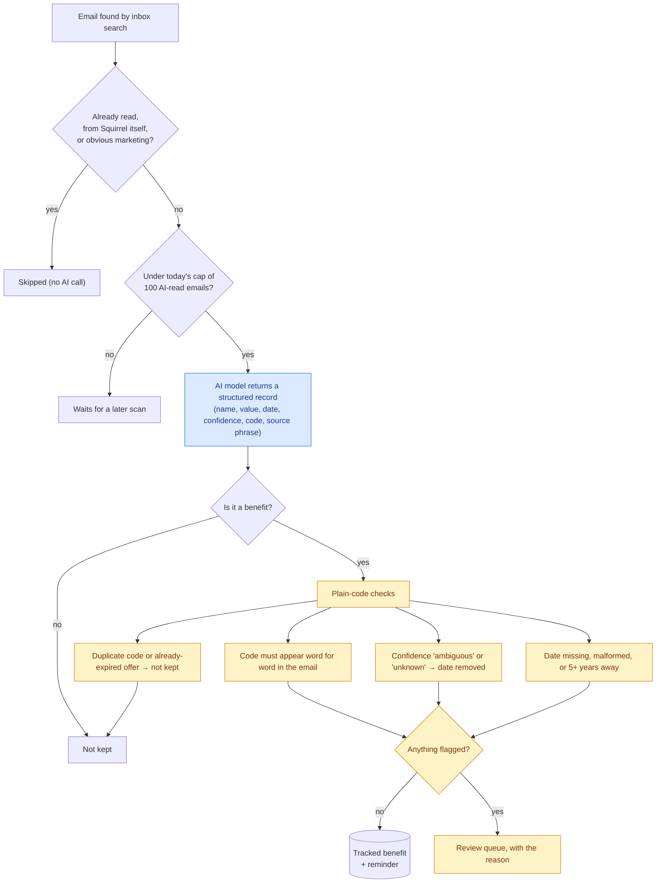

<table>
  <tr>
    <td width="62%">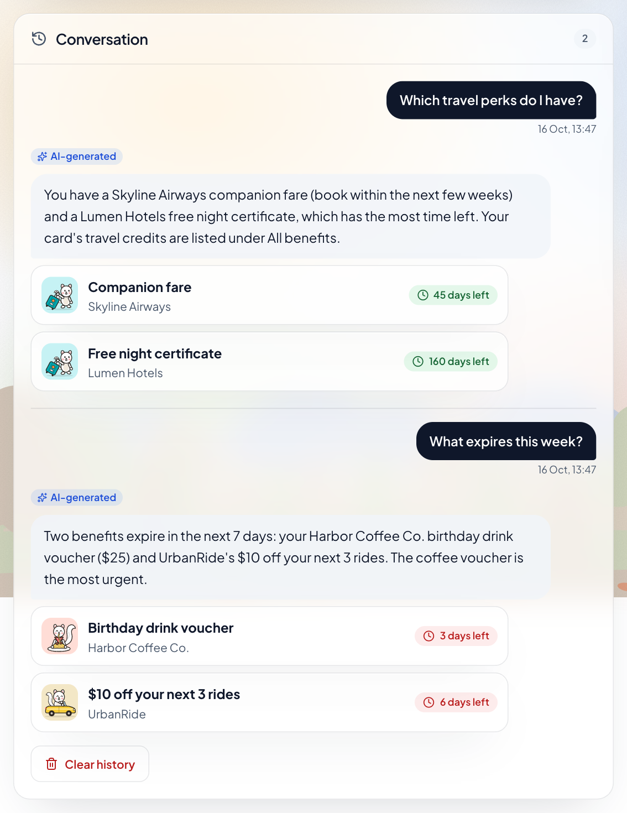<br/><sub><b>Assistant.</b> Answers come only from your own benefits, with the ones it mentions listed underneath.</sub></td>
    <td width="38%">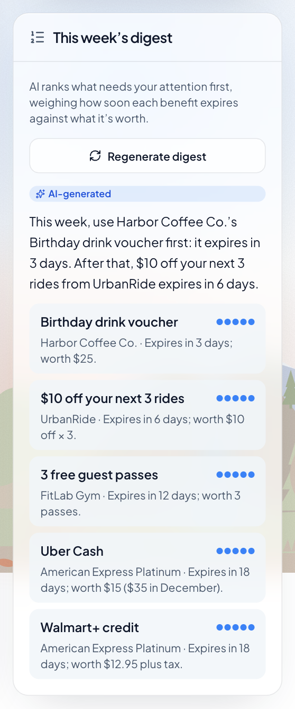<br/><sub><b>Weekly digest.</b> Made when you press Generate: benefits ranked by urgency, with a short summary.</sub></td>
  </tr>
</table>

<sub>In the demo shown here, these answers come from simple rules that stand in for the AI; in the real app they come from the OpenAI model, labelled "AI-generated".</sub>

**How the AI is called.** Extraction and the digest use **strict structured outputs**: the API forces the reply to match a JSON schema, so there is no free-text parsing. All three features share one client (`call_structured` / `call_text` in `app.py`) that handles retries with backoff, refusals, cut-off output and clear error messages. Requests are sent with `store: false`, so OpenAI doesn't keep the response for later retrieval.

**Prompt design.** The extraction prompt's central rule is to *never guess a date*: a missed reminder is a small inconvenience, but a wrong reminder date is a real failure. It also covers reading Singapore day/month dates, "end of October", date ranges, emails listing several coupons, and what doesn't count as a benefit (ads for new credit cards, menu prices, newsletters, "buy more, get a bonus" offers). Today's date and the email's received date are given so relative wording ("valid for 6 months") can be worked out.

## 5. External tools and datasets

### How the pieces connect

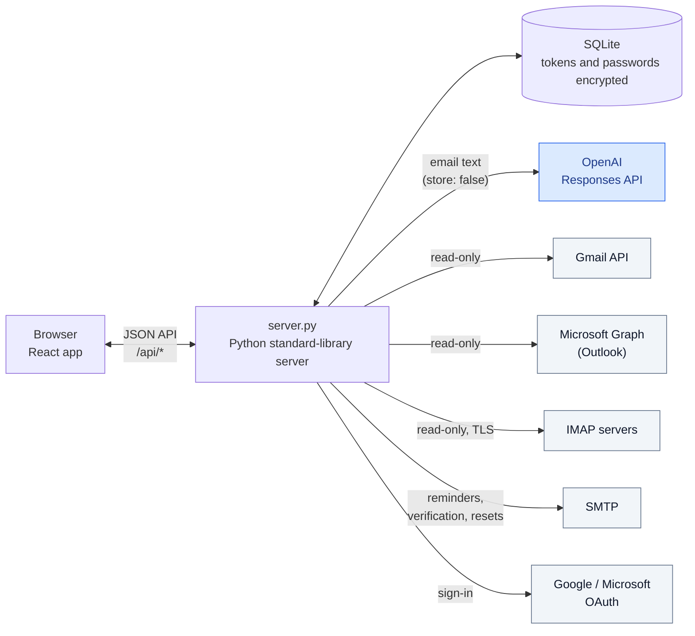

**APIs and models**
- **OpenAI Responses API** with `gpt-5.4-mini` (set by `OPENAI_MODEL`; `gpt-5.5` if it's left unset): extraction, digest and assistant.
- **Gmail API** and **Google OAuth 2.0 / OpenID Connect** (PKCE): Google sign-in and read-only Gmail (`gmail.readonly`).
- **Microsoft Graph** and the **Microsoft identity platform** (PKCE): read-only Outlook mail (`Mail.Read`).
- **IMAP** (TLS, port 993): any other mail provider, with an app password.
- **SMTP** (e.g. Gmail with an app password): reminder, verification and password-reset emails.

All HTTP calls use Python's standard library (`urllib`); no vendor SDKs are needed.

**Backend libraries** (Python 3.10+; the rest is the standard library)
- `cryptography` (Fernet) to encrypt stored OAuth tokens and IMAP passwords.
- `tzdata` for time zones.
- `pytest` for tests.
- SQLite for storage.

**Frontend libraries**
- React 19, TypeScript, Vite, Tailwind CSS v4.
- `lucide-react` (icons), `three` (3D landing-page art).
- `zxing-wasm` and `barcode-detector` (scanning QR codes and barcodes with the camera).

**Data**
- **Credit-card perk catalog** ([`cards.py`](cards.py)): hand-written for 5 US and 20 Singapore cards, checked against the issuers' own web pages in October 2026 (a few Singapore figures, such as the UOB Lady's cap and fee and the Maybank fee, came from comparison sites). The Singapore cards were chosen from popularity rankings on comparison sites (SingSaver, MoneySmart).
- **Loyalty-program list** ([`loyalty.py`](loyalty.py)): 13 hotel and airline programs, their sending domains and their points-expiry rules.
- No external training datasets; the model is used as-is, with no fine-tuning.

**Development tools**
- The UI/UX Pro Max design skill (in `.claude/skills/`) for the design system, and Claude Code for development help.

## 6. Installation and setup

### Prerequisites
- Python 3.10 or newer
- Node.js 20.19+ or 22.12+ (required by Vite), with npm
- An OpenAI API key (for scanning, the digest and the assistant)
- Optional: a Google Cloud OAuth client (Google sign-in and Gmail), a Microsoft app registration (Outlook), SMTP details (emails)

The app runs without the optional parts: email-and-password sign-in, adding benefits by hand, credit cards and IMAP scanning all work with just the OpenAI key. Without SMTP, reset and reminder emails are printed in the server's terminal.

### Steps

1. **Get the code**
   ```bash
   git clone https://github.com/haid1lau/squirrel.git
   cd squirrel
   ```

2. **Install the Python dependencies**
   ```bash
   python3 -m pip install -r requirements-dev.txt
   ```

3. **Configure settings.** Copy the template and fill in at least `OPENAI_API_KEY`:
   ```bash
   cp .env.example .env
   ```
   `.env.example` explains each setting. Never commit `.env`.

4. **Build the frontend**
   ```bash
   cd frontend && npm ci && npm run build && cd ..
   ```

5. **Start the server**
   ```bash
   python3 server.py
   ```
   Then open **http://127.0.0.1:8000** (use `127.0.0.1`, not `localhost`, so the sign-in cookie and Google's redirect address match). The database and encryption key are created in `instance/` on first run.

6. **Optional: load sample data.** `python3 demo_seed.py` creates a demo account with sample benefits, a credit card and items to review, and prints its email and password.

7. **Run the tests**
   ```bash
   python3 -m pytest
   ```

### Optional: Google sign-in and Gmail
1. In [Google Cloud Console](https://console.cloud.google.com), create a project and enable the **Gmail API**.
2. Under **Google Auth Platform**, set the app name, choose **External** audience in **Testing**, and add yourself as a test user.
3. Add the scopes `openid`, `email`, `profile` and `https://www.googleapis.com/auth/gmail.readonly`.
4. Create a **Web application** client with the redirect URI `http://127.0.0.1:8000/api/auth/google/callback`.
5. Put the client ID and secret in `.env` as `GOOGLE_CLIENT_ID` and `GOOGLE_CLIENT_SECRET`, and restart the server.

### Optional: Outlook
1. In the [Azure portal](https://portal.azure.com), go to **Microsoft Entra ID → App registrations → New registration**, allowing organizational and personal Microsoft accounts.
2. Add a **Web** redirect URI: `http://localhost:8000/api/auth/microsoft/callback`.
3. Add the delegated Microsoft Graph permissions `Mail.Read`, `User.Read` and `offline_access`.
4. Create a client secret and put it and the application ID in `.env` as `MICROSOFT_CLIENT_SECRET` and `MICROSOFT_CLIENT_ID`, then restart the server.

### Frontend development
Run `npm run dev` in `frontend/` for live reload at http://localhost:5173; it forwards `/api` requests to `server.py`, which must also be running. The server doesn't reload code, so restart it after backend changes.

### Demo without a server
```bash
cd demo-frontend && npm ci && npm run dev
```
Sign in with any password as `clayton@demo.com`, `priya@demo.com`, `marcus@demo.com` or `sam@demo.com`. See [`demo-frontend/README.md`](demo-frontend/README.md) for deploying it on Vercel.

## 7. AI safety and limitations

### Risks
- **Wrong expiry dates.** The worst failure: a reminder on the wrong day means a lost benefit, or false confidence that it's still valid.
- **Invented details.** A model could make up a voucher code, a benefit that isn't there, or a date in the digest or assistant.
- **Misclassifying emails.** Ads for new cards, newsletters and menu prices can look like benefits; real benefits can be skipped.
- **Privacy.** Emails are personal. Squirrel sends their text to OpenAI and stores access to the user's inbox.
- **Cost.** Every email read and every digest or question costs money; a runaway scan could run up a bill.
- **Prompt injection.** An email could contain text written to steer the model.

### Guardrails
- **Structured outputs, not free text.** The model can only answer in the schema's shape, including an explicit confidence level for the date.
- **"Never guess a date" rule**, backed by code: a date marked `ambiguous` or `unknown` is removed, and the benefit goes to the review queue with a reason.
- **Plain-code validation** ([`validate`](app.py) in `app.py`): flags missing or malformed dates and dates more than 5 years away. During a scan, an offer whose date has already passed isn't kept at all. The model can't mark its own output as reviewed, and can't set points, reminders or usage.
- **Voucher codes must appear word for word in the email**, or they're dropped. A wrong code at the till is worse than none.
- **Digest and assistant are grounded.** They see only the user's own records; IDs the model invents are dropped; dates waiting for review are withheld from the digest and the assistant is told not to state them as fact; days until expiry are worked out in code, not by the model.
- **The user stays in control.** Every benefit can be edited or removed, removals can be undone for 30 days, and each review item shows why it was flagged and the email's own words for the date.
- **Limited model influence.** Model output only fills in benefit records; it never triggers actions, sends emails or changes settings, which limits what prompt injection in an email could do. Emails are cut to 8,000 characters.
- **Privacy.** Inbox access is read-only. OAuth tokens and IMAP passwords are encrypted at rest (Fernet). OpenAI requests use `store: false`. Squirrel's own reminder emails are excluded from scans. Loyalty detection reads only sender, subject and date, with no AI. Users can disconnect an inbox or delete their account and all its data.
- **Cost limits.** At most 100 emails per user per day go to the AI, a non-AI filter skips obvious marketing emails, an email the AI fails on 3 times is skipped, and each user gets at most 30 questions, 10 digests and 10 scans an hour. The digest is cached until the benefits change. The daily scan is off by default.
- **Account security.** Scrypt password hashes, throttled wrong passwords, same-origin checks on requests, security headers and a Content-Security-Policy, protection against account pre-hijacking via Google sign-in, and email verification before any reminder is sent to an address.

### Testing
- **115 automated server tests** (`python3 -m pytest`, about 10 seconds), covering the validation of AI output, the scan safeguards (marketing filter, daily cap, retries), the daily scan, card reset dates (including leap years and anniversaries), recently removed and restore, accounts and sign-in, reminders and time zones, and the API end to end, including that one user can never see or change another's benefits. Each test gets its own empty database, and any test that tries to make a web request (OpenAI, Google, Microsoft) or send email over SMTP fails.
- **Checked against real emails.** The 22 benefits found by a real Gmail scan were compared with their emails: every saved value and voucher code matched (5 of 5 codes word for word), but 3 dates were missed, 1 benefit was a duplicate and 3 weren't benefits (15 of 22 fully right). The prompt and code were fixed (day/month dates, "end of month", date ranges, what isn't a benefit, skipping duplicates and expired offers) and the problem emails re-run correctly. A second scan of 50 emails led to further prompt fixes, after which 11 of 13 saved benefits were right; the 2 that weren't went to review or picked the wrong deal date.
- **Manual browser checks** of each screen in light mode, dark mode and at phone width.

### Known limitations
- **Extraction accuracy is not yet measured with a repeatable evaluation**, only spot-checked on real emails. Date formats beyond the ones fixed may still be misread; offers without a code that arrive in several emails can be listed twice.
- **Long emails are cut to 8,000 characters**, so details at the end of long forwarded threads can be missed.
- **The prompt assumes a Singapore user** for numeric dates (day/month), so US-style dates may be misread unless the email is clearly American.
- **Card perks and loyalty rules are hand-written** and go out of date when issuers change them; each card shows when it was last checked.
- **Loyalty expiry is an estimate** from email subject lines, and always goes to review.
- **Not covered by automated tests:** the inbox scanners against real mail servers, the AI features themselves and the React screens.
- **Built for a small group of testers, not a public launch:** SQLite and one server process, rate limits and scan progress kept in memory, and reminders sent from inside the web server (none go out while it's stopped). Gmail access is a Google *restricted* scope: in Testing mode only listed users can connect, and they must reconnect every 7 days. A public launch would need Google's verification and security assessment, Microsoft publisher verification, HTTPS hosting and a proper email sending service.
- **The assistant isn't financial advice.** It reports what's in the user's records and can be wrong; users should check a benefit's terms with its provider.
